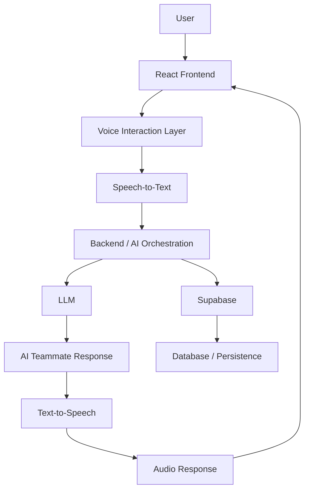

# Perspective 🎙️

### Experience careers before choosing them.

Perspective is an AI-powered career simulation platform that enables users to explore different professions through interactive, voice-based workplace simulations.

Instead of relying on career descriptions, videos, or generic assessments, Perspective allows users to experience realistic professional scenarios, collaborate with AI teammates, solve practical problems, and gain a deeper understanding of what working in a particular profession actually involves.

**The goal is to make career exploration experiential, interactive, and accessible.**

<p align="center">
  <a href="https://perspective-voice.vercel.app/">Live Demo</a> •
  <a href="https://github.com/tachyon29/perspective-voice">GitHub Repository</a>
</p>

---

## Table of Contents

- [Problem Statement](#problem-statement)
- [Solution](#solution)
- [Features](#features)
- [System Architecture](#system-architecture)
- [Technical Stack](#technical-stack)
- [How It Works](#how-it-works)
- [Repository Structure](#repository-structure)
- [Getting Started](#getting-started)
- [Environment Configuration](#environment-configuration)
- [Running Locally](#running-locally)
- [Development Workflow](#development-workflow)
- [Security Considerations](#security-considerations)
- [Future Improvements](#future-improvements)
- [Contributing](#contributing)
- [Author](#author)

---

## Problem Statement

Career decisions are often made without meaningful exposure to the actual work involved in a profession.

Students frequently depend on online resources, academic guidance, and anecdotal experiences when deciding what career to pursue.

This creates several challenges:

- **Limited practical exposure:** Students rarely get the opportunity to experience professional workflows before choosing a career.
- **Information asymmetry:** Access to industry professionals and career mentorship is often concentrated in metropolitan cities and established institutions.
- **Lack of experiential learning:** Traditional career guidance explains what a profession involves but does not allow students to perform the work themselves.
- **Language barriers:** Career exploration resources are not always accessible in a student's preferred language.
- **Uncertainty in career selection:** Individuals may invest years pursuing a profession without understanding whether its day-to-day responsibilities align with their interests.

## Solution

Perspective transforms career exploration into an interactive simulation environment.

Users can enter a simulated workplace, interact with AI-powered teammates, participate in realistic professional scenarios, and experience the responsibilities associated with different career paths.

For example, a user exploring software engineering could participate in a simulated engineering team, discuss technical problems, and work through a software development task.

The platform aims to bridge the gap between understanding a profession and experiencing it.

---

## Features

### 1. AI-Powered Voice Teammates

Interact with AI teammates through natural voice conversations.

The teammates simulate workplace colleagues who can respond to questions, provide context, discuss problems, and collaborate with the user.

### 2. Realistic Career Simulations

Explore professions through scenarios inspired by real-world professional workflows.

Simulations focus on practical tasks rather than passive content consumption.

### 3. Interactive Problem Solving

Users can discuss problems, ask follow-up questions, brainstorm ideas, and make decisions within the simulation.

### 4. Voice-First Interaction

The platform uses voice-based interaction to create a more natural and immersive experience.

Speech input and audio output reduce the need for continuous text-based communication.

### 5. Career Discovery

Users gain exposure to:

- Professional responsibilities
- Workplace collaboration
- Problem-solving approaches
- Skills required for different professions
- Challenges encountered in real-world work environments

### 6. Accessibility-Oriented Design

Perspective is designed with the goal of making career exploration accessible to students regardless of their geographical location or educational background.

Regional-language support is part of the broader vision.

---

## System Architecture

Perspective follows a client-server architecture that separates the user interface, AI interaction logic, and supporting infrastructure.



The diagram represents the conceptual architecture of the application. The specific services and communication paths depend on the configured implementation.

### Component Responsibilities

| Component | Responsibility |
|---|---|
| Frontend | Provides the user interface, career selection, simulation experience, and interaction controls. |
| Voice Interaction Layer | Coordinates audio input and output. |
| Speech-to-Text (STT) | Converts spoken user input into text that can be processed by the AI system. |
| Backend | Handles application logic, requests, AI orchestration, and communication with external services. |
| Large Language Model (LLM) | Generates contextual responses and simulates workplace teammates. |
| Text-to-Speech (TTS) | Converts generated text into spoken audio. |
| Supabase | Provides supporting database and backend infrastructure where configured. |

---

## Technical Stack

### Frontend

**React**

React is used to build the interactive user interface using reusable components.

It enables the application to manage UI state, render simulation interfaces, and create an interactive experience without requiring full-page reloads.

**JavaScript**

JavaScript powers the application logic, user interactions, API communication, and client-side state management.

**Modern Web APIs**

Browser APIs support capabilities such as microphone access, audio playback, and other client-side interactions.

### Artificial Intelligence

**Large Language Models (LLMs)**

LLMs are responsible for generating contextual responses from simulated AI teammates.

The model receives conversational context and simulation instructions to produce responses aligned with the selected professional scenario.

**AI Orchestration**

The AI orchestration layer coordinates model interactions, simulation context, and the application workflow.

This layer is responsible for ensuring that AI teammates respond within the context of the career simulation.

### Voice Processing

**Speech-to-Text (STT)**

Converts user speech into text that can be passed to the AI system.

**Text-to-Speech (TTS)**

Converts AI-generated responses into audio, enabling users to communicate with simulated teammates through voice.

### Backend and Infrastructure

**Backend Services**

The backend handles application-specific business logic and integration with AI and external services.

**Supabase**

Supabase provides supporting infrastructure for database operations and application data persistence, where configured.

**Vercel**

The live demo is deployed using Vercel.

---

## How It Works

A typical user interaction follows this workflow:

1. The user selects a career simulation.
2. The application initializes the simulation context.
3. The user interacts with an AI teammate through voice.
4. Speech input is converted into text using the speech recognition layer.
5. The backend processes the input along with the simulation context.
6. The LLM generates a contextual response.
7. The response is converted into audio using the speech synthesis layer.
8. The frontend plays the response to the user.
9. The conversation continues as the user explores the simulated professional environment.

The system is designed to make interactions feel closer to conversations with real workplace colleagues rather than conventional chatbot exchanges.

---

## Repository Structure

The repository is organized into separate areas for the frontend, backend, documentation, and supporting infrastructure.

```text
perspective-voice/
│
├── backend/
│   └── Backend application and AI integration
│
├── frontend/
│   └── React application and user interface
│
├── docs/
│   └── Project documentation
│
├── supabase/
│   └── Database and Supabase configuration
│
├── .gitignore
├── AGENTS.md
└── README.md
```

The directory descriptions are high-level. Refer to the individual directories for the actual implementation and configuration files.

---

## Getting Started

Follow the instructions below to set up Perspective for local development.

### Prerequisites

Ensure that the following tools are installed:

- Git
- Node.js (LTS version recommended)
- npm
- A code editor such as Visual Studio Code

If the backend requires Python or additional services, install the versions specified by its dependency files.

### 1. Clone the Repository

```bash
git clone https://github.com/tachyon29/perspective-voice.git
```

Navigate to the project directory:

```bash
cd perspective-voice
```

### 2. Set Up the Frontend

Navigate to the frontend directory:

```bash
cd frontend
```

Install dependencies:

```bash
npm install
```

Start the development server:

```bash
npm run dev
```

The frontend development server will display the local URL in the terminal. Open that URL in your browser.

### 3. Set Up the Backend

Open a separate terminal and navigate to the backend directory:

```bash
cd perspective-voice/backend
```

Install the backend dependencies using the package manager and dependency file provided in the backend directory.

For a Python backend, this would typically involve creating a virtual environment and installing the requirements:

```bash
python3 -m venv venv
```

Activate the environment on macOS or Linux:

```bash
source venv/bin/activate
```

Install dependencies if a `requirements.txt` file is present:

```bash
pip install -r requirements.txt
```

Start the backend using the entry point and command configured in the project.

> Note: The backend startup command and dependency installation instructions should be adjusted to match the actual backend implementation.

---

## Environment Configuration

Perspective integrates with external AI and voice services. These services may require API keys and configuration values.

Create the required environment files according to the frontend and backend configuration.

Example configuration:

```env
# AI Configuration
LLM_API_KEY=your_llm_api_key

# Voice Configuration
STT_API_KEY=your_speech_to_text_api_key
TTS_API_KEY=your_text_to_speech_api_key

# Backend Configuration
BACKEND_URL=http://localhost:8000

# Supabase Configuration
SUPABASE_URL=your_supabase_url
SUPABASE_ANON_KEY=your_supabase_anon_key
```

These are illustrative variable names, not a verified list of the repository's required environment variables.

Use the actual names expected by the application.

### Important

- Never commit API keys or secrets to GitHub.
- Keep backend-only credentials in server-side environment variables.
- Use `.env.example` to document the required configuration without exposing secrets.
- Ensure `.env` files are included in `.gitignore`.
- Configure production environment variables separately from local development variables.

---

## Development Workflow

The recommended development workflow is:

1. Clone the repository.
2. Install frontend and backend dependencies.
3. Configure the required environment variables.
4. Start the backend services.
5. Start the frontend development server.
6. Open the application in the browser.
7. Test the voice interaction flow.
8. Inspect logs and network requests when debugging.

### Debugging

Useful areas to inspect during development:

- Browser developer console for frontend errors.
- Network tab for API requests and responses.
- Backend logs for request processing and AI errors.
- Environment configuration for missing API keys.
- Microphone permissions and browser audio settings for voice-related issues.

---

## Security Considerations

Perspective integrates with external AI services and processes user interactions.

Security considerations include:

- Protecting API credentials.
- Avoiding exposure of privileged backend keys.
- Validating requests on the backend.
- Restricting access to sensitive database operations.
- Handling user audio and conversation data responsibly.
- Avoiding unnecessary storage of sensitive user information.

---

## Future Improvements

Potential directions for further development include:

- Expanding simulations across software engineering, product management, research, finance, and other professions.
- Introducing multilingual voice interactions.
- Developing more sophisticated AI teammate orchestration.
- Adding structured career assessments based on simulation performance.
- Supporting personalized career exploration paths.
- Introducing persistent simulation sessions.
- Improving simulation realism through scenario-specific tools and workflows.

---

## Contributing

Contributions, ideas, and feedback are welcome.

If you are interested in improving Perspective:

1. Fork the repository.
2. Create a feature branch.
3. Implement your changes.
4. Test the functionality locally.
5. Submit a pull request with a clear description of the changes.

For major changes, consider opening an issue first to discuss the proposed implementation.

---

## Author

**Aman**


- GitHub: [@tachyon29](https://github.com/tachyon29)
- Project: [Perspective](https://github.com/tachyon29/perspective-voice)
- Live Demo: [perspective-voice.vercel.app](https://perspective-voice.vercel.app/)

---

## License

Refer to the repository for licensing information.

---

⭐ If you find Perspective interesting, consider starring the repository.

**Don't just read about a career. Experience it.**
